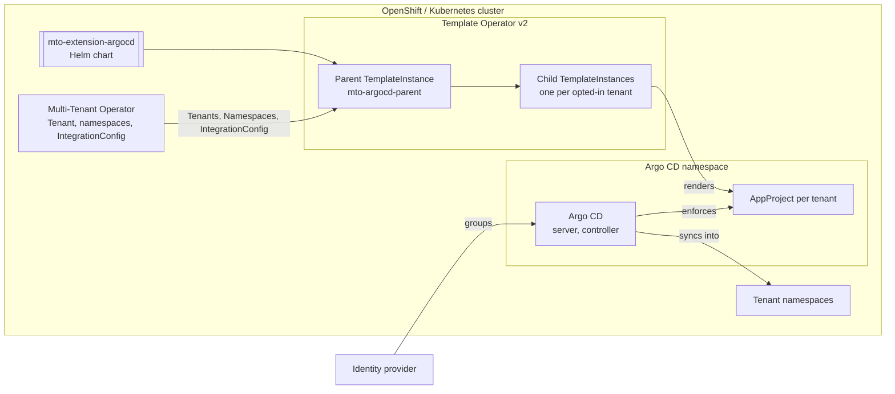
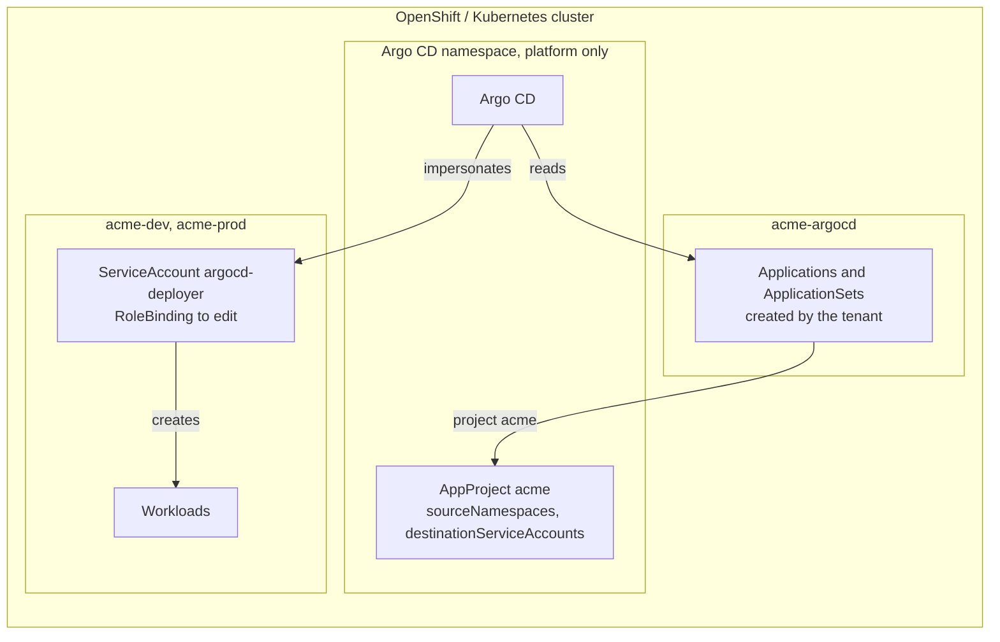

# Diagrams

## C4 — Container (today)



## C4 — Container, with the opt-ins on



## Sequence — onboarding a tenant (today)

```mermaid
sequenceDiagram
  autonumber
  participant P as Platform team
  participant T as Template Operator v2
  participant A as Argo CD
  participant U as Tenant owner
  P->>P: annotate Tenant acme: argocd...enabled=true
  T->>T: parent emits child for acme
  T->>A: AppProject acme (destinations, sourceRepos, roles)
  U->>A: sign in; group matches acme-owner
  U->>A: create Application in project acme → acme-dev
  A->>A: destination allowed; sync
```

## Sequence — a sync with impersonation (opt-in)

```mermaid
sequenceDiagram
  autonumber
  participant U as Tenant member
  participant A as Argo CD
  participant K as Kubernetes API
  U->>A: Application in acme-argocd, project acme, dest acme-dev
  A->>A: sourceNamespaces allows acme-argocd
  A->>K: apply as system:serviceaccount:acme-dev:argocd-deployer
  K-->>A: allowed for Deployments; refused for ClusterRoles
```
