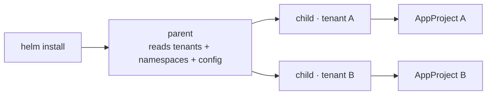
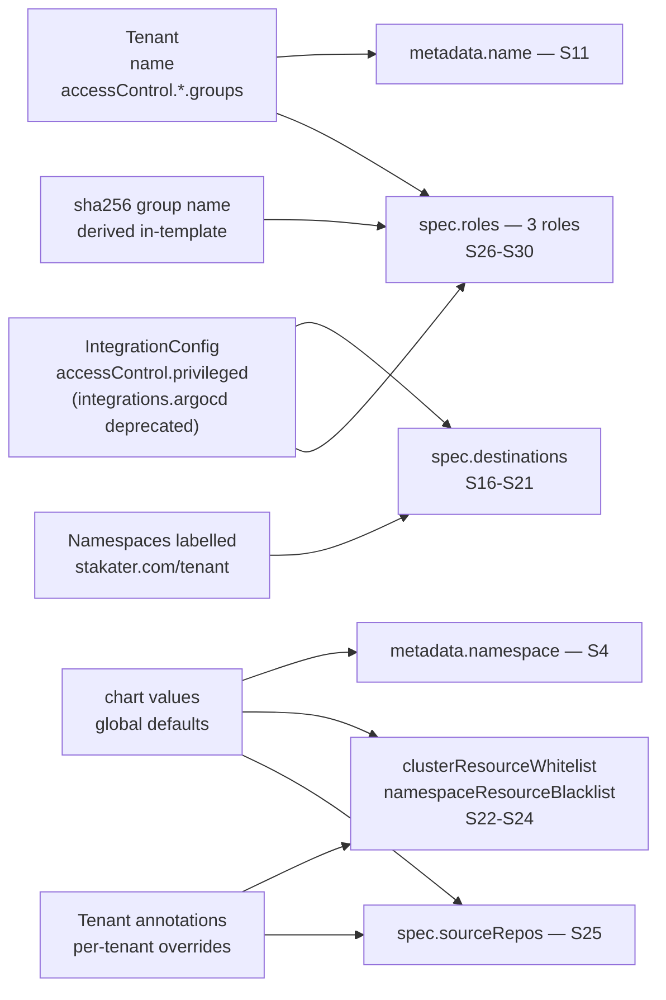
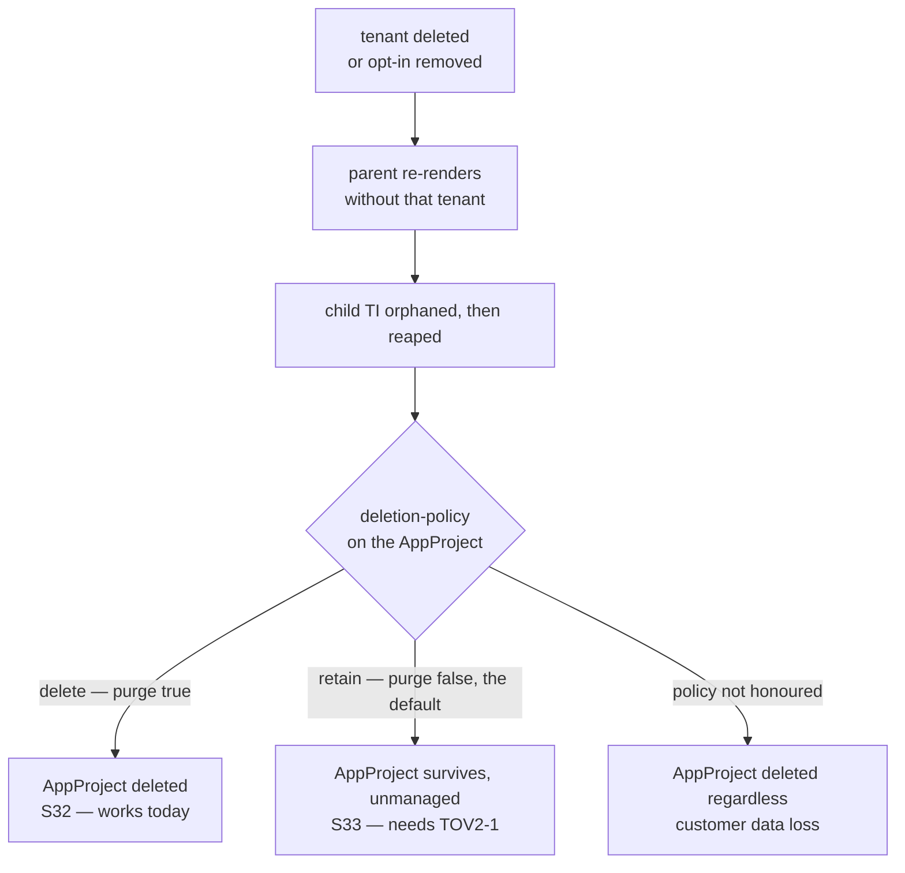
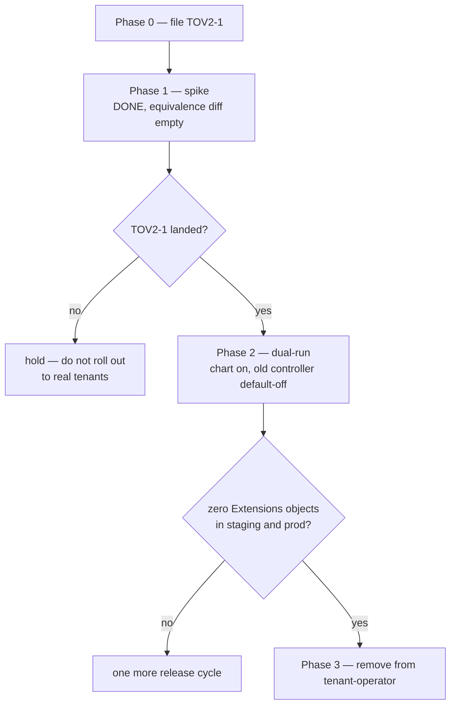

# Move the ArgoCD extension out of tenant-operator

> [!IMPORTANT]
> **Superseded in places — this is the design record, not the current behaviour.**
>
> These documents were written before the chart existed and before it was run on
> a cluster. Building and testing it reversed several decisions recorded here.
> Where they disagree with the chart, the chart is right. Known reversals:
>
> | Recorded here | Actual |
> |---|---|
> | `sync.mode: revert` by default | `strict`, with two mandatory `ignoreFields` exemptions |
> | `strict` needs tov2 >= 0.0.6 | the webhook ships in v0.0.3 |
> | child TemplateInstances named `mto-argocd-<tenant>` | `mto-argocd-tenant-<tenant>`, so a Tenant named `parent` cannot collide with the parent |
> | fixed cluster-scoped RBAC names | release-scoped, or a second install fails |
> | bash render harness copied from openbao | Go, mirroring template-operator-v2's own function map |
> | a blank `argocd.namespace` renders zero children | it renders one per tenant, each of which then fails |
> | the IntegrationConfig read is fail-closed as written | it failed OPEN until fixed; absence is now an error |
>
> Live behaviour is in [../live-deployment.md](../live-deployment.md); upstream
> defects are in [../upstream-issues.md](../upstream-issues.md).

> **Status:** for approval · **Owner:** Ayesha Arshad · **Date:** 2026-08-03
>
> Self-contained. Asking for sign-off on the approach (§1), the behaviour changes (§6), and the
> migration sequence (§6); plus answers to the open questions (§10).
>

## 1. Why do this

ArgoCD is the **last integration still living inside tenant-operator**. Grafana, OpenBao and Harbor all
moved out into their own repos; ArgoCD didn't.

Three concrete costs of leaving it:

1. **It drags a heavy dependency into the whole operator.** tenant-operator imports the ArgoCD Go
   libraries, and those force the entire operator onto a pinned Kubernetes library version. Every
   cluster running MTO pays for that, including the many that don't use ArgoCD at all.
2. **It can't be released independently.** An ArgoCD fix waits for a tenant-operator release.
3. **The integration story is inconsistent** — three extensions outside, one inside, and no stated
   reason why.

## 2. How it works today

An admin does two things:

1. Sets the ArgoCD namespace once, in the cluster's `IntegrationConfig`.
2. Writes an **`Extensions`** custom resource naming a tenant — this is the opt-in.

A controller inside tenant-operator then watches for those, and for each one builds an ArgoCD
**AppProject**: the object that says which namespaces that tenant may deploy into, and which groups get
owner / edit / view access.

If either step is missing, nothing happens. Nothing else creates those `Extensions` resources — a human
writes them.

## 3. How it will work

- Replace the controller with a **Helm chart**. No Go, no CRD, no image, no OLM bundle.
- template-operator-v2 — already running in every MTO cluster — generates the AppProjects.
- Two levels:
  - a **parent** reads the tenant list, the namespaces and the `IntegrationConfig`;
  - it creates one **child** per tenant, and each child produces that tenant's AppProject.
- **Why two levels:** one bad tenant then fails only its own child. Per-tenant isolation, per-tenant status.



**tenant-operator loses:** the ArgoCD controller, the `Extensions` CRD, its separate Deployment, and
the ArgoCD Go dependency — which then lets us drop the Kubernetes version pin from §1.

### Proven on a live cluster, 2026-08-03

Run alongside the existing controller, two real tenants, OpenShift 4.20. Artifacts:
[spike-argocd-tov2/](spike-argocd-tov2/).

- **Output is identical.** Every AppProject field diffed — destinations, roles, access rules,
  description, resource restrictions. No differences, and still none after changing cluster config.
- **Group names match.** Access depends on names hashed from the tenant name; the chart recomputes them
  identically. Wrong here would silently cut off every tenant.
- **Existing AppProjects can be adopted** — taken over without delete or duplicate, stale metadata cleaned.
- **Cost per edit is constant.** Changing one tenant updates only that tenant.
- **Permissions are tightly scoped.** Cluster-wide write is not needed, and is confirmed denied.
- **32 of 51 catalogued behaviours verified live** (§5); the rest by code reading. One gap: the rule
  keeping platform namespaces out of a tenant's AppProject could not be exercised here, and getting it
  wrong exposes one tenant to another. Needs a dedicated test.

> **Current tests are thinner than they look.** 811 lines, but nothing asserts the namespace list, the
> access rules, or platform-namespace filtering — and one test claiming to cover config inheritance is
> written backwards and passes without testing anything. So about half of this is being tested for the
> first time, not carried over.

## 4. Gaps and tickets

**Nothing here blocks starting.** The chart, the templates, the golden files and the spike were all
built against template-operator-v2 as it stands. One ticket gates the production rollout.

| Ticket | Repo | What it changes | Until it lands |
|---|---|---|---|
| **TOV2-1** retain on delete | template-operator-v2 | Lets a rendered resource outlive its TemplateInstance — which is what `onDeletePurgeAppProject: false` means | **S33, S34 and S37 have no implementation.** `handleDeletion` deletes every rendered resource unconditionally, so retain degrades to purge and deleting a tenant destroys its AppProject. Fine for a spike; **never for a cluster with real tenants** |
| **MTO-1** group names on `Tenant.status` | tenant-operator | Makes the generated group names visible in `kubectl get tenant -o yaml` | Nothing. The chart derives the names itself and the §8 equivalence test pins them |
| ~~per-apply identity~~ | — | **Do not file.** Already in flight as [tov2 PR #49](https://github.com/stakater-ab/template-operator-v2/pull/49), which adds `TemplateInstance.spec.serviceAccountRef` and impersonates it. **Reads only** — apply, drift, orphan deletion and outputs stay on the operator identity, so §5's RBAC split is still required | n/a |

### TOV2-1 — what to ask for

- **Surface:** an annotation the template stamps on the rendered resource, so the decision is
  per-tenant: `templates.v2.stakater.com/deletion-policy: Delete|Orphan`. A TemplateInstance-level
  default is a reasonable addition but is not sufficient alone.
- **Vocabulary:** use `Orphan`, not `retain`. grafana's CRD already declares
  `spec.deletionPolicy: Delete|Orphan`. Note there is **no implementation to copy** — that enum value
  is declared and never read, so setting it there silently does nothing.
- **Default:** `Delete`, preserving today's behaviour for every existing consumer.
- **Seam:** `deleteRenderedResource` already returns without deleting when the object lacks
  `RenderedResourceFinalizer`.

> **The trap, and the whole point of the ticket.** That seam makes *"just don't stamp ownership"* look
> like a free implementation of retain. It is not. Ownership discovery, drift correction and orphan
> detection all key off the same labels, so a resource stripped of ownership metadata also stops
> receiving **updates** and stops being orphan-tracked — it would freeze at its creation-time content
> forever. Because retain is the *default* path for this consumer, that breaks every tenant while
> reporting success. It must be a **delete-time policy check**: keep stamping ownership, keep
> reconciling for the TemplateInstance's whole life, and consult the policy only in `handleDeletion`.

- **Acceptance:** two rendered resources, one annotated `Orphan`; deleting the TI removes one and leaves
  the other; the retained object carries **no** dangling finalizer and is manually deletable; while
  the TI lives, **both** keep receiving updates on re-render; and **deleting a parent whose children
  render retained resources leaves those resources in place** (§13 — this is the `helm uninstall` case,
  and the cascade is confirmed to reap children and their rendered objects today).

### MTO-1 — what to ask for

Add to `TenantStatus`, populated as `fmt.Sprintf(GroupNameFormat, name, role, GenerateHashedID(name, role))`:

```go
// Groups reports the operator-generated group names for each tenant role.
// +optional
Groups *TenantGroupsStatus `json:"groups,omitempty"`

type TenantGroupsStatus struct {
    Owner  string `json:"owner,omitempty"`
    Editor string `json:"editor,omitempty"`
    Viewer string `json:"viewer,omitempty"`
}
```

**The chart derives the hash itself; MTO-1 does not change that.** `GenerateHashedID` is
`hex(sha256("<tenant>-<role>"))[:6]`, and `sha256sum (printf "%s-%s" $name "owner") | trunc 6`
reproduces it exactly — verified live, see §4. Tenant name and role are both known at render time, so
this is a pure function of data the template already holds, with fewer moving parts than trusting
another controller's status write. A chart reading `.status.groups.owner` would still need a fallback
for tenants that have not reconciled since the MTO upgrade, so it keeps the derivation as a branch
rather than removing it. Adopt `.status.groups` later, once the chart can require a minimum MTO version.

## 5. Every behaviour in the current implementation

This is the parity contract. Every row must be implemented in `mto-extension-argocd`, or explicitly
signed off as a change in §7.

> Companion to [PLAN-argocd-extension-extraction.md](PLAN-argocd-extension-extraction.md).
> **This is the implementation contract.** Every row must be implemented in `mto-extension-argocd`, or
> explicitly signed off as a change in the plan's behaviour-change table.
> **Verified against a live cluster on 2026-08-03** — see [spike-argocd-tov2/](spike-argocd-tov2/):
> S1, S4, S6, S9, S10, S11, S12, S13, S14, S15, S16, S19, S20, S21, S22, S23, S24, S25, S26, S27,
> S28, S30, S31, S32, S33, S34, S38, S39, S40, S43, S44, S45 (32 of 51), plus §5.10 (nothing else is
> set on the AppProject).
>
> **Partially verified:** S29 (group *order* could not be exercised — this cluster has no privileged
> groups and the tenants declare no groups of their own) · S46 (only the `AppProjectSynced` reason was
> observed).
>
> **Code-verified only, and the one that matters:** **S7/S17** — privileged-namespace exclusion. No
> privileged namespace on the cluster is tenant-labelled, and MTO's own managed-prefix webhook refuses
> to let one be labelled by hand, so the filter never ran. A privileged namespace leaking into a
> tenant's `destinations` is cross-tenant exposure, so this needs a synthetic golden fixture in the new
> repo. Also code-only: S2, S3, S5, S18, S35, S36, S37, S41, S42, S47, S48-S51.

Which input decides which AppProject field — the whole of §5.3-5.6 in one picture:



`spec.description` is a constant (S13). Nothing else on the AppProject is set — see §5.10.

### 5.1 Inputs and preconditions

| # | Behaviour today | Where | New repo |
|---|---|---|---|
| S1 | IntegrationConfig is the singleton `tenant-operator-config` in the operator namespace (**namespaced**, not cluster-scoped) | controller.go:88 | Parent TI resolves it by name + namespace via `objectFieldRef` |
| S2 | IC missing → status `IntegrationConfigNotFound`, return nil, **no requeue** | controller.go:88-93 | Parent TI parameter resolution fails → parent condition. No AppProjects touched |
| S3 | `ic.spec.integrations.argocd == nil` → no-op. Existing AppProjects are **left orphaned** | controller.go:181-184 | **Superseded 2026-08-06.** The chart no longer reads `integrations.argocd`, so this trigger disappears; turning ArgoCD off is now `scaffoldingMode: Never`, removing the marker, or `helm uninstall`, each of which emits zero children and reaps the AppProjects (subject to the retain policy). **The old safety argument went with it:** an unreadable IC used to fail parameter resolution and leave children untouched. The replacement guard is `argocd.namespace` `required` in `values.schema.json`, so a blank value cannot install and cause a mass reap |
| S4 | Argo namespace = `ic.spec.integrations.argocd.namespace` (required field) | controller.go:230 | **Changed 2026-08-06:** chart value `argocd.namespace`, marked `required` in `values.schema.json`; the IC field is deprecated. The schema guard is load-bearing — a blank value renders zero children and reaps every AppProject |
| S5 | CRD `appprojects.argoproj.io` must exist; absent → hard error, no AppProject | controller.go:210-217 | A CRD-existence `objectFieldRef` with `defaultValue: absent`, branched on in the parent gotemplate (§6). No tov2 change needed |
| S6 | Tenant named by `spec.tenantName` must exist; absent → error returned, retried with backoff, **no status written** | controller.go:200-207 | N/A — tenants are the iteration source, so a missing tenant means no child TI |
| S7 | Privileged namespaces come from `ic.spec.accessControl.privileged.namespaces` via `config.PrivilegedNamespaces` | config.go:293,335 | **Read from the IC parameter, not a chart value.** Closes the drift/cross-tenant-exposure risk. **Confirmed 2026-08-06:** stays IC-read, and no `privileged` section is added to chart values |
| S8 | Privileged groups come from `ic.spec.accessControl.privileged.groups` | controller.go:248 | Same — from the IC parameter |

**Why `accessControl.privileged` is not part of the IC deprecation.** Felix's 2026-08-06 deprecation covers
`integrations.argocd.*` only. `accessControl.privileged` is core MTO config with four non-ArgoCD consumers,
so it is not going anywhere and the chart should keep reading it rather than duplicating it:

- [namespace.go:76](../../internal/webhook/webhook/namespace.go#L76) — namespace admission webhook
- [namespace_controller.go:127](../../internal/controller/namespace/namespace_controller.go#L127) — skips privileged namespaces
- [util.go:33](../../internal/webhook/webhook/util.go#L33) — pod webhook, `PrivilegedServiceAccounts`
- [integrationconfig_util.go:62](../../internal/controller/integrationconfig/integrationconfig_util.go#L62) and [integrationconfig_rolescaching.go:40](../../internal/controller/integrationconfig/integrationconfig_rolescaching.go#L40) — Casbin policies and role caching

A chart-values copy could drift from what MTO enforces, and a privileged namespace reaching a tenant's
`destinations` is cross-tenant exposure. A subtractive override would be worse, so there is no override.

### 5.2 Opt-in

| # | Behaviour today | Where | New repo |
|---|---|---|---|
| S9 | A tenant gets an AppProject **only** if a user authored an `Extensions` CR naming it. Nothing in-cluster creates them | grep of `internal/`, `pkg/` | **Changed** — tenants are the iteration source, so every tenant would get one. Gate it with `scaffoldingMode`, reusing grafana's vocabulary verbatim (see below) |
| S10 | Two `Extensions` CRs naming the same tenant fight over one AppProject, last writer wins — and **both report `appProjectState: true`**, so status cannot tell you which is authoritative (verified live) | none (unguarded) | Cannot happen: one child TI per tenant, named after the tenant |

**S9 in detail — `scaffoldingMode`, and why it is not optional.** Do not invent a new name for this:
- **Do not invent a name.** `mto-extension-grafana` already ships this as `ScaffoldingMode`
  ([enum_types.go:126-135](../../../mto-extension-grafana/api/v1alpha1/enum_types.go)):
  `Always` / `OnLabel` / `OnAnnotation` / `Never`, defaulting to **`OnAnnotation`**.
- Reuse all four values and the field name, so the extension family stays coherent.

- **Explicit opt-in is already the house default**, and it matches today's ArgoCD behaviour — not a migration hack.
- **Phase 2 is unprovable without it.** The gate is "any non-empty AppProject diff stops the rollout", and a mode that scaffolds every tenant guarantees a non-empty diff by creating AppProjects that never existed.
  - On the verification cluster: 2 tenants, 0 `Extensions` CRs, therefore 0 AppProjects. Auto-scaffolding would produce 2, and no diff could then separate "renders correctly" from "creating things it shouldn't".
- **Keep `Never` too** — it lets the chart be installed and its render inspected without touching a single AppProject.
- **Sequence:** ship `OnAnnotation` (or `OnLabel`) → prove equivalence → move to `Always` as a deliberate, announced change.

### 5.3 AppProject identity and shape

| # | Behaviour today | Where | New repo |
|---|---|---|---|
| S11 | `metadata.name` = tenant name, `metadata.namespace` = argo namespace | controller.go:231 | Same |
| S12 | **No `ownerReferences`.** Lifecycle is finalizer + purge flag only, never Kubernetes GC | k8sobjects.go:224, controller.go:245-253 | Same — tov2 uses labels + its own finalizer, not ownerRefs |
| S13 | `spec.description` = `"Managed by Extensions controller"` | controller.go:249 | **Changed** to `"Managed by mto-extension-argocd"`. Announce it — it is a visible spec diff |
| S14 | Uses `CreateOrPatch`: creates when absent, patches only the six fields it sets, leaves everything else alone | controller.go:245 | tov2 uses SSA (`client.Apply` + `ForceOwnership`, field manager `template-operator`). Fields owned by another manager are preserved — parity, not a regression |
| S15 | Any `tenantoperator.stakater.com/v1beta2` `Tenant` ownerRef is stripped from a pre-existing AppProject, on **every** reconcile where the AppProject already exists | utils.go:166-181 | **Not expressible in a template** — a template cannot mutate metadata it does not own. Needs a migration Job (Helm hook). See the provenance note below: this is narrower but more urgent than it looks |

### 5.4 Destinations

| # | Behaviour today | Where | New repo |
|---|---|---|---|
| S16 | Destinations = every namespace labelled `stakater.com/tenant=<tenant>` | controller.go:288-293 | Parent filters the Namespace LIST by that label |
| S17 | Minus privileged namespaces. Matching is **unanchored** `regexp.MatchString`, so `openshift` matches `my-openshift-tools` | namespace_utils.go:22-40 | Reproduce unanchored regex semantics in gotemplate (`regexMatch`), including the quirk |
| S18 | If the IC cannot be read at startup the privileged list defaults to `[".*"]` — matches everything, collapsing destinations to the argo namespace alone | config.go:40,275 | Does not carry over: the chart reads the live IC or fails loudly. Strict improvement |
| S19 | Argo namespace is appended **unconditionally**, after filtering — even if it is itself privileged | controller.go:304-308 | Same |
| S20 | Every destination uses `server: https://kubernetes.default.svc` | metadata.go:183 | Same. Multi-cluster is out of scope |
| S21 | Zero-namespace tenant still gets an AppProject, with the argo namespace as its only destination | controller.go:269,296-308 | Same. **Do not copy openbao's `$hasNs` skip guard** — skipping is correct for openbao and a silent regression here |

### 5.5 Resource restrictions and source repos

| # | Behaviour today | Where | New repo |
|---|---|---|---|
| S22 | `clusterResourceWhitelist` defaults from IC, overridden by the CR when `!= nil` — an explicit **empty list overrides with empty**; an omitted key inherits | controller.go:278-285 | **Changed 2026-08-06:** default from **chart values**, overridden by a Tenant annotation. Same nil-vs-empty semantics — annotation absent inherits, annotation `[]` overrides with empty. Test both |
| S23 | `namespaceResourceBlacklist` same, and the two override **independently** — one `if` per field, not one around both | controller.go:279-284 | Same, and still independent — one annotation per field |
| S24 | `[]metav1.GroupKind` → `ClusterResourceRestrictionItem{Group, Kind}`; the `Name` glob is never set | appproject.go:148-155 | Same. Do not add `name` |
| S25 | `sourceRepos` comes only from the CR; no IC default; **optional there**, so absent → nil → the AppProject permits no repos and nothing in it can sync | controller.go:232-235 | **Decided 2026-08-06:** global `sourceRepos.pattern` in chart values, expanded per tenant; per-tenant override via annotation. Ships **empty** so today's behaviour is preserved for the Phase 2 diff. See §12. Note the guardrail regression: `spec.argocd.sourceRepos` was `required` on v1beta2 `Tenant` and became optional when it moved to the `Extensions` CR |

### 5.6 Roles

| # | Behaviour today | Where | New repo |
|---|---|---|---|
| S26 | Exactly three roles: `<tenant>-owner`, `<tenant>-edit`, `<tenant>-view` | utils.go:127-164 | Same |
| S27 | Policies, verbatim: owner and edit `p, proj:<t>:<t>-<role>, *, *, <t>/*, allow`; view `p, proj:<t>:<t>-view, *, get, <t>/*, allow` | utils.go:137,148,159 | Same, character for character |
| S28 | Descriptions are three fixed strings (note: edit and view both say "to the tenant owner group" — a copy-paste bug in the original; **preserve it** for byte parity, fix separately) | utils.go:136,147,158 | Same |
| S29 | Group order per role: MTO-generated name, then IC privileged groups, then the tenant's own `accessControl.<owners\|editors\|viewers>.groups`. **The tenant's `users` are never included** | utils.go:132-138 | **Changed — see the roles defect below.** Add the tenant's `users` too. Order still matters for diffs |
| S30 | Generated name = `<tenant>-<role>-group-<hash>`, hash = `hex(sha256("<tenant>-<role>"))[:6]`, roles are the literals `owner`/`edit`/`view`. **This name only resolves to a real object on OpenShift** — see below | metadata.go:152,159-162; tenant_util.go:659-665 | Keep it (additive, no platform branching needed in a chart), but it is no longer the only entry. Derive with `sha256sum (printf "%s-%s" $name "owner") \| trunc 6` |

- Worked example for `bluesky`, verified: `bluesky-owner-group-5558a7` · `bluesky-edit-group-758bb0` ·
  `bluesky-view-group-618752`. Use as golden-test fixtures.

> **Roles defect — the generated group is OpenShift-only, so vanilla Kubernetes tenants get no access.**
>
> - The tenant controller creates `Group/<tenant>-<role>-group-<hash>` **only** under
>   `case constants.PlatformTypeOpenshift` (`tenant_create_update.go:72-84` → `syncOCPGroups`), and it
>   populates that Group from the tenant's `accessControl.<role>.users`.
> - The AppProject lists **only that group name** — never the users. Verified live: tenant `pe` declares
>   `owners.users: [ayesha.arshad@stakater.com]`, and its AppProject role groups are
>   `[pe-owner-group-489fab]` alone.
> - **On vanilla Kubernetes no Group object is ever created**, so the AppProject names a group nobody is
>   in, and the tenant's users have no ArgoCD access at all. This is a pre-existing bug, not something
>   the move introduces.
> - **Fix (Felix, 2026-08-05):** populate `role.groups` from the tenant spec directly — its `groups`
>   **and** its `users` — rather than relying on the generated group.
> - **This works, and it is measured, not inferred.** `role.groups` entries render into casbin *grouping*
>   policies (`g, <entry>, proj:<p>:<role>`), and ArgoCD enforces on the token's subject **before**
>   checking group claims (`server/rbacpolicy/rbacpolicy.go:82-112`). Evaluated against ArgoCD's own
>   enforcer with `argocd admin settings rbac can`, on the exact policy an AppProject role produces:
>
>   | Subject | Result |
>   |---|---|
>   | `alice@corp.com` — a bare **username** in `role.groups` | **Yes** |
>   | `platform-team` — a **group** name (today's mechanism) | Yes |
>   | `bob@corp.com` — not listed *(negative control)* | No |
>   | `alice@corp.com`, different project *(negative control)* | No |
>
>   So casbin grouping does not care whether the left-hand side names a user or a group. Felix's fix is
>   mechanically sound.
> - **The username must match ArgoCD's computed subject, and here is the exact rule.**
>   `jwtutil.GetUserIdentifier` (`util/jwt/jwt.go:143-166`) returns `federated_claims.user_id` when Dex
>   sets it, and otherwise falls back to `sub`. With Dex, `sub` is an **opaque base64 blob**, never a
>   username — so the match depends entirely on `federated_claims.user_id`, which Dex populates from the
>   upstream connector's user id.
>   - **MTO does not control this.** MTO's Dex integration configures the **Console**
>     (`internal/controller/pilot/pilot_dex.go`), not ArgoCD. ArgoCD's SSO is configured by whoever
>     installs ArgoCD, so the answer is per-cluster, not per-codebase.
>   - **On OpenShift with the OCP OAuth connector**, `federated_claims.user_id` is the OpenShift
>     username — which is exactly what MTO stores in tenant `users` (e.g. `ayesha.arshad@stakater.com`).
>     So a match is very likely on SAAP, but that is inference, not measurement.
>   - **Our Dex has no OpenShift connector.** `dex-config-operator`'s `Connector` CRD restricts `type` to
>     `oidc | google | saml | ldap | github | gitlab | bitbucket | microsoft`
>     (`api/v1alpha1/connector_types.go:60-64`). So the subject is never an OpenShift username by
>     construction — it is whatever the upstream IdP issues through that connector.
>   - **For Dex local users** (`LocalUser` CR = staticPasswords), `federated_claims.user_id` is the CR's
>     own `userID` field, which is directly inspectable.
>   - **So this is a deployment-configuration property, not a code property.** Whether it matches depends
>     on the connector in use and on what gets written into `Tenant.spec.accessControl.*.users` — neither
>     of which this repo controls.
>   - **The one-command check**, per environment: `argocd account get-user-info` (or
>     `GET /api/v1/session/userinfo`) returns the subject ArgoCD computed. Compare with the tenant's
>     `users` entry. If they differ, adding users to `role.groups` grants nothing and the fix needs a
>     claim mapping instead.
>   - **Recommendation:** ship the fix regardless. It is strictly additive (§10), it is the only thing
>     that can work on vanilla Kubernetes, and where the strings do not line up the answer is an IdP
>     mapping — not a reason to keep an OpenShift-only mechanism.
> - **Keep the generated group as well.** A chart cannot easily detect the platform, and keeping it is
>   purely additive — on Kubernetes it is an inert entry, on OpenShift it stays the working binding. No
>   existing OpenShift tenant loses access.
> - **Consequence for §9 Phase 2 — measured on the live cluster, 2026-08-05.** Re-ran the spike with the
>   fix applied and diffed against the Go controller's output. Exactly **one** field differs:
>
>   ```
>   fields differing: ['roles']
>     pe-owner: groups ['pe-owner-group-489fab']
>            -> ['pe-owner-group-489fab', 'ayesha.arshad@stakater.com']
>   ```
>
>   Nothing else in the role changed — policies, description and name are untouched — and `pe-edit` /
>   `pe-view` are unchanged because that tenant declares no editors or viewers. **A tenant with no
>   `users` stays byte-identical.** So the Phase 2 gate should assert exactly this one difference and
>   treat any other as a failure.

**S30 is a three-controller join key, not an ArgoCD detail.** The same
The same `GroupNameFormat` + `GenerateHashedID` pair is used by three controllers:

- **tenant controller** — creates the real Group objects ([tenant_create_update.go:272-288](../../internal/controller/tenant/tenant_create_update.go#L272), deleted at [tenant_delete.go:224-240](../../internal/controller/tenant/tenant_delete.go#L224))
- **namespace controller** — RoleBinding subjects ([namespace_util.go:175-177](../../internal/controller/namespace/namespace_util.go#L175), [namespace_create_update.go:268-292](../../internal/controller/namespace/namespace_create_update.go#L268))
- **this extension** — AppProject role groups

So a drifting derivation does not just break ArgoCD — it breaks the join between AppProject roles and
the groups MTO actually creates, cluster-wide, with no error anywhere. That is why the §11 equivalence
test is non-optional. It is **not** an argument for reading `.status` instead of deriving; see §4.

- **Role ordering is test-enforced** in both existing suites (`Roles[0]/[1]/[2]` = owner/edit/view, `Groups[0]` = the generated name). Treat as contract, not incidental.

### 5.7 Deletion

The third branch below is what tov2 does today, for every tenant — which is why TOV2-1 gates the
production rollout rather than the build:



| # | Behaviour today | Where | New repo |
|---|---|---|---|
| S31 | Finalizer `tenantoperator.stakater.com/appproject` added on first reconcile | controller.go:101-110 | tov2's own `RenderedResourceFinalizer` |
| S32 | Delete + `onDeletePurgeAppProject: true` → AppProject deleted | controller.go:129-133 | Child rendered **without** the retain annotation |
| S33 | Delete + purge false (the default) → **AppProject survives, unmanaged** | controller.go:134-136 | Child rendered **with** `deletion-policy: retain`. **Needs TOV2-1** |
| S34 | `spec.argoCD` absent at delete time → nothing purged | controller.go:137-139 | Default is retain, so absence of config never destroys |
| S35 | IC has no argocd block, or an empty namespace, at delete time → deletion skipped | controller.go:318-321 | Same effect: nothing to render, nothing to delete |
| S36 | AppProject already gone → treated as success | controller.go:328-331 | tov2 tolerates NotFound on delete |
| S37 | Finalizer removed after the purge decision, whichever way it went | controller.go:142-147 | Retained AppProjects must carry **no dangling finalizer** — TOV2-1 acceptance criterion |

**A compound failure observed live, which no single scenario captures.** With two `Extensions` CRs for
one tenant (S10):

- Deleting the CR whose `onDeletePurgeAppProject` is `true` **destroys the shared AppProject**, even though the other CR still exists and still claims to own it.
- Nothing recreates it — there is no AppProject watch (S43).
- The surviving CR keeps reporting `appProjectState: true` (S44), so no signal appears anywhere.
- In the observed run it reappeared **only** because an unrelated namespace deletion happened to enqueue the survivor.
- **Net effect:** a tenant can lose its ArgoCD RBAC and regain it minutes later for reasons unconnected to either CR.
- The chart's one-child-per-tenant model removes the whole class. Worth stating as a benefit, not leaving implicit.

### 5.8 Triggers

| # | Behaviour today | Where | New repo |
|---|---|---|---|
| S38 | `For(Extensions)` | controller.go:165 | Child TI reconcile |
| S39 | Watches IntegrationConfig → enqueues **all** Extensions, but only for the default IC; also refreshes `config.PrivilegedNamespaces` and friends as a side effect | controller.go:154-158, utils.go:27-62 | Parent watches the IC via `objectFieldRef`; the global-variable refresh has no analogue and needs none |
| S40 | Watches Namespace → the single Extensions whose `tenantName` matches the ns label. Namespaces without the label are ignored | utils.go:65-102 | Parent watches the Namespace GVK cluster-wide (one watch, not one per tenant) |
| S41 | Global `WithEventFilter(GenerationChanged OR LabelChanged)` — applies to **all three** watches, so a namespace label change is admitted but an annotation-only change is not | controller.go:164 | tov2 re-resolves on any change to a watched GVK. Slightly chattier; acceptable |
| S42 | **No Tenant watch.** Editing `tenant.spec.accessControl.owners.groups` does not re-render roles until an unrelated event fires | controller.go:152-168 | **Fixed** — the parent watches the Tenant GVK. Announce as a behaviour change |
| S43 | **No AppProject watch.** Out-of-band deletion or edit is never repaired (the controller's own TODO, line 1) | controller.go:1 | **Fixed** — tov2 tracks rendered resources and re-applies. Announce |

### 5.9 Status

| # | Behaviour today | Where | New repo |
|---|---|---|---|
| S44 | `status.argocd.appProjectState` (bool) and `status.argocd.argoNamespace`. **It is written only at sync time and never re-evaluated** — verified live: after deleting the AppProject out of band, the CR still reported `appProjectState: true, reason: AppProjectSynced`. The field does not mean "the AppProject exists", it means "the last sync succeeded" | utils.go:105-118 | Child TI: `Ready` condition + `renderedResources[0].status`; `argoNamespace` as a `spec.outputs` field. **Strict improvement** — tov2 tracks the rendered resource, so this cannot go stale the same way |
| S45 | Exactly one condition, whose `Type` **is** the reason string — so condition types are unbounded and `kubectl wait --for=condition=Ready` cannot work | utils.go:109-117 | **Fixed** — tov2's properly typed conditions |
| S46 | Reasons used: `IntegrationConfigNotFound`, `AppProjectSynced`, `AppProjectDeletionFailed`, `AppProjectDeletionSucceeded` | controller.go:91,259,340,346 | Map each to a tov2 condition/output. Document the mapping in `MIGRATION.md` |
| S47 | Database controller watches `Extensions` and writes an audit row via the wrapped client | database_controller.go:74 | **Lost.** The database controller watches template-operator **v1** TemplateInstances, not v2, so the replacement is not audited either. See §4 |

### 5.10 Not implemented today — do not add

Never set today — do not add:

- `sourceNamespaces` · `destinationServiceAccounts` · `clusterResourceBlacklist` · `namespaceResourceWhitelist`
- `orphanedResources` · `signatureKeys` · `permitOnlyProjectScopedClusters`
- the `Name` glob on cluster-resource restrictions · multi-cluster destinations
- project-scoped repo credentials · `argocd-rbac-cm` · ApplicationSets
- `SyncWindow`/`SyncWindows` builder methods exist with **no callers** — dead code

Also absent:

- **No validating webhook for `Extensions`** (checked `internal/webhook/`). Nothing validates that `spec.tenantName` names a real tenant, or that `integrations.argocd.namespace` exists. Do not go looking for one to port.

### 5.11 Legacy `Tenant` v1beta2 ArgoCD surface — still served, silently ignored

Predates the `Extensions` CRD and is easy to miss, because none of it is wired to anything.

| # | Behaviour today | Where | New repo |
|---|---|---|---|
| S48 | `Tenant` **v1beta2** still declares `spec.argocd.sourceRepos` (required, no `omitempty`) and `spec.argocd.appProject.{clusterResourceWhitelist,namespaceResourceBlacklist}` | v1beta2/tenant_types.go:113-127,143-144 | Nothing reads them. Inherited as-is |
| S49 | v1beta2 also declares `spec.onDelete.cleanAppProject`, **defaulting to `true`** | v1beta2/tenant_types.go:100-102,166 | This is the historical ancestor of `onDeletePurgeAppProject`, whose default is `false`. The purge default was flipped at some point; retain is correct going forward |
| S50 | v1beta2 declares `status.argocd.{appProject,argoNamespace}` | v1beta2/tenant_types.go:182-188,204-205 | Superseded by the child TI's status |
| S51 | The v1beta2 → v1beta3 conversion **drops all of S48-S50 silently** — there is no ArgoCD handling anywhere in the 269-line conversion webhook | v1beta2/tenant_webhook.go | Unchanged, and pre-existing — **not** a regression the extraction causes. But see the deployment defect below: on a real cluster the silent drop may never even be reached |

Two consequences worth acting on:

- **Provenance of S15, and why the Job is narrow but urgent.** The Tenant controller really did set
  a **controller** ownerRef on the AppProject — `SetControllerReference(tenant, appProj, r.Scheme)`,
  live from **v0.3.12** (2022-02-21) until it was commented out in **v0.11.3** (`6e9d4d51`,
  2024-03-20), with the AppProject moving to the Extensions controller two weeks later. A *controller*
  ownerRef means the garbage collector deletes the AppProject when the Tenant goes away, **overriding
  `onDeletePurgeAppProject` entirely** — that is the failure `removeOldOwnerReference` prevents.

  - The strip runs on **every reconcile**, so any tenant with an `Extensions` CR was cleaned long ago.
  - Surviving refs are on AppProjects the controller **never reconciled** — tenants nobody authored a CR for, in a cluster that ran v0.3.12-v0.11.2.
  - Those are exactly the AppProjects the new chart adopts first, since it opts in every tenant.
  - So the Job's target set is small and precisely definable — and it must run **before** the parent adopts anything.
- Leave the v1beta2 CRD schema alone. Removing those fields is a separate conversion concern and is
  explicitly out of scope for this extraction.

- **Deployment defect found while verifying S48-S51 on a live cluster — file separately, unrelated to
  this plan.** The Tenant CRD ships `spec.conversion.webhook.clientConfig.service` pointing at
  **`multi-tenant-operator/tenant-operator-webhook-service`**, but a Helm/OLM install that places MTO
  in another namespace (observed: `stakater-tenant-operator`) leaves that namespace non-existent. Every
  v1beta2 request then fails outright:

  ```text
  Internal error occurred: conversion webhook for tenantoperator.stakater.com/v1beta2, Kind=Tenant
  failed: Post "https://tenant-operator-webhook-service.multi-tenant-operator.svc:443/convert":
  service "tenant-operator-webhook-service" not found
  ```

  - So v1beta2 is **advertised as served but entirely unusable** — not "accepted and ignored".
  - `IntegrationConfig`'s v1alpha1 → v1beta1 conversion is configured the same way, so it has the same defect.
  - Worth checking whether the chart templates that namespace at all.

## 6. What template-operator-v2 can and cannot express

Read from tov2's `internal/pkg/params/resolver.go` and `internal/controller/`.

| Verdict | Count | Scenarios |
|---|---|---|
| **Expressible today** | 40 | S1-S5, S7-S14, S16-S30, S32, S35, S36, S38-S46 |
| **Needs TOV2-1** | 3 | S33, S34, S37 — the retain half of the purge fork |
| **Needs a migration Job** (ours, no tov2 change) | 1 | S15 — stripping the v1beta2 ownerRef |
| **Dropped / subsumed** | 3 | S6, S31, S47 |

S32 (purge → delete) already works — but for *every* tenant. Making it **per-tenant selectable** is
what TOV2-1 buys.

**Four capabilities carry the design:**

- **Parameters resolve to structured values**, not strings. A LIST yields whole objects, so the
  template can `range` tenants and read `$t.metadata.labels`, `$t.spec.accessControl.owners.groups`
  directly. Stringified only for status display.
- **A named reference evaluates JSONPath over the whole object**, so one ref with `jsonPath: .spec`
  returns the entire IntegrationConfig spec as a map.
- **A LIST always returns a slice**, even for a single result — so zero tenants or zero namespaces
  `range` over nothing instead of failing. This is what makes S21 work with no guard.
- **Rendering a `TemplateInstance` is allowed**, so parent → child fan-out is supported.

**`defaultValue` masks missing data — and that is how S5 is done.** Only three error classes bypass it
(`InvalidSelector`, `ClusterScopedSelector`, `NamespaceLookup`); a missing CRD, a missing object and a
JSONPath matching nothing all fall back to the default. So the CRD-existence check is just a parameter:

```yaml
- name: appProjectCRD
  valueFrom:
    objectFieldRef:
      apiVersion: apiextensions.k8s.io/v1
      kind: CustomResourceDefinition
      name: appprojects.argoproj.io
      jsonPath: .metadata.name
  defaultValue: "absent"      # CRD missing -> masked to "absent"
```

The parent branches on it and can `fail` with a clear message. No tov2 change needed.

**Two rules for reading objects:**

- **Read shallowly, test sub-keys in the template.** A deep path like `.spec.integrations.argocd` fails
  the parent outright with no default, and with one degrades to a *string* where a map is expected.
  Read `.spec` once, then `hasKey`. (An empty string is not a usable default.)
- **Same for tenants:** read whole objects and `default` any missing key.

## 7. Chart design


### 7.1 Repo layout

```text
mto-extension-argocd/
  charts/mto-extension-argocd/
    Chart.yaml
    values.yaml
    templates/
      00-rbac.yaml                    # SA + ClusterRole for tov2 to manage AppProjects
      10-child-template.yaml          # renders ONE tenant's AppProject
      20-parent-template.yaml         # ranges over tenants, emits child TIs
      30-parent-templateinstance.yaml # the only TI in git
      90-migration-job.yaml           # one-shot: strip v1beta2 Tenant ownerRefs (helm hook) — S15
    files/
      parent-gotemplate.tpl
      child-gotemplate.tpl
  tests/golden/                       # helm template golden files, one per S-scenario
  examples/  README.md  MIGRATION.md  Makefile  .github/workflows/
```

- No `go.mod`, `cmd/`, `api/`, `config/`, `Dockerfile`, `bundle/`, `catalog/`.

### 7.2 Parent TemplateInstance

```yaml
apiVersion: templates.v2.stakater.com/v2alpha1
kind: TemplateInstance
metadata:
  name: mto-argocd-parent
  namespace: multi-tenant-operator
spec:
  templateRef: { name: mto-argocd-parent, namespace: multi-tenant-operator }
  parameters:
    - name: tenants
      valueFrom:
        objectFieldRef:
          apiVersion: tenantoperator.stakater.com/v1beta3
          kind: Tenant
          jsonPath: .items            # no name → cluster-wide LIST, watched
    - name: namespaces
      valueFrom:
        objectFieldRef:
          apiVersion: v1
          kind: Namespace
          jsonPath: .items            # cluster-scoped LIST; filtered per tenant in gotemplate
    - name: integrationConfig
      valueFrom:
        objectFieldRef:
          apiVersion: tenantoperator.stakater.com/v1beta1
          kind: IntegrationConfig
          name: tenant-operator-config
          namespace: multi-tenant-operator
          jsonPath: .spec             # supplies S7, S8 only — privileged namespaces and groups
```

- **Three parameters, three watches, independent of tenant count.** Verified live (§3).
- **The IC ref survives the 2026-08-06 deprecation, narrowed to `accessControl.privileged`.** S4, S22 and
  S23 now come from chart values. Keep `jsonPath: .spec` and `dig` in the template — a deep
  `.spec.accessControl.privileged` fails the parent outright when the field is absent (§6).
- **Never put a `defaultValue` on this parameter.** Masking a failed read yields an empty privileged list,
  which puts privileged namespaces into tenants' `destinations` — cross-tenant exposure. Failing the parent
  is fail-closed and matches MTO's own `[".*"]` fallback (S18).
- **No `namespaceSelector` anywhere.** It scopes *where to look for a namespaced kind*; it is not a
  filter on `Namespace` objects and errors on cluster-scoped targets (templateinstance_types.go:154-165).
  Namespaces are resolved parent-side as a cluster-wide LIST and filtered in the template. Three
  consequences, all wins:
  - `NamespaceSelectorMatchedZero` never fires
  - one namespace watch, not one per tenant
  - privileged filtering happens in exactly one place
- **The IntegrationConfig ref is one shallow `.spec`**, not two deep paths — a deep path fails the
  parent outright when the field is absent (§6).
- Each parameter resolves and watches independently (`watch_helpers.go:80-81`).

### 7.3 Which tenants get a child — the scaffolding filter

The parent's first job is deciding *whether* to emit a child. One conditional inside the loop over the
tenant list — no child emitted means no AppProject:

```gotemplate
{{- range $t := .parameters.tenants }}
  {{- $name   := $t.metadata.name }}
  {{- $labels := default dict $t.metadata.labels }}
  {{- $annos  := default dict $t.metadata.annotations }}
  {{- $take := false }}
  {{- if eq $mode "Always" }}{{- $take = true }}
  {{- else if eq $mode "OnLabel" }}{{- $take = eq (index $labels $key) "true" }}
  {{- else if eq $mode "OnAnnotation" }}{{- $take = eq (index $annos $key) "true" }}
  {{- end }}
  {{- if $take }}
      … emit TemplateInstance mto-argocd-{{ $name }} …
  {{- end }}
{{- end }}
```

- **Mirror grafana's spec shape, not just its enum:** `scaffolding.mode` plus a **configurable**
  `scaffolding.annotations` map, so the match key is the platform team's choice, not hardcoded
  (`ScaffoldingSpec`, grafana_types.go:233-243).
- **grafana declares `OnLabel` but ships only an `Annotations` map** — so that mode is dead there.
  Decide deliberately whether to add a `labels` map here, and raise the inconsistency with them.
- **The shift is where opt-in lives.** Today: a separate object, deleted to opt out. After: a marker on
  the Tenant itself, or blanket-on. Same decision, different home.

### 7.4 Child rendering

Per tenant, the parent hands down:

- tenant name · filtered namespace list · argo namespace (chart value)
- effective resource lists — chart-value defaults, overridden per tenant by annotation · privileged groups (IC)
- the tenant's own role groups (or `.status.groups` after MTO-1)
- its effective `sourceRepos` — the chart's `pattern` with `{{ tenant }}` expanded, or the tenant's
  annotation override · its purge flag

**The four per-tenant overrides are annotations on the `Tenant`** (decided 2026-08-06, §12). Keys under
`argocd.tenantoperator.stakater.com/`, values JSON-encoded for the two `{group, kind}` lists:

```yaml
metadata:
  annotations:
    argocd.tenantoperator.stakater.com/enabled: "true"                     # the scaffolding marker
    argocd.tenantoperator.stakater.com/source-repos: '["https://github.com/acme/apps"]'
    argocd.tenantoperator.stakater.com/cluster-resource-whitelist: '[{"group":"","kind":"Namespace"}]'
    argocd.tenantoperator.stakater.com/namespace-resource-blacklist: '[]'  # explicit empty overrides
    argocd.tenantoperator.stakater.com/on-delete-purge: "false"
```

- **Absent annotation inherits the chart default; `[]` overrides with empty** — the nil-vs-empty semantics
  of S22/S23, expressible in annotations without ambiguity.
- **Malformed JSON must fail the child, never fall back to the default.** Applies are server-side, so a
  silent fallback would *strip* `sourceRepos` from a live AppProject.

The child renders the AppProject per §5.3-5.6 and stamps
`templates.v2.stakater.com/deletion-policy: Orphan` unless purge is enabled (S32/S33).

### 7.5 Status

**Per-tenant status is the child TI:**

- `conditions` · `renderedResources[]` (per-resource `status` and `observedGeneration`)
- `resolvedParameters` — mark the `namespaces` parameter `exposeInStatus: true`
- `spec.outputs` for `argoNamespace` and `destinationCount`
- Set `keyTemplate: "{.metadata.name}"` explicitly — the `fromAll` default is
  `{.metadata.namespace}/{.metadata.name}`, and every AppProject shares one namespace
- `status.matchedNamespaces` is **not** populated — it only exists for `namespaceSelector` parameters,
  which this chart does not use

**Aggregate view — declare it on the parent.**

- The parent's rendered output *is* the set of child TIs, so a `fromAll` over `TemplateInstance` collapses every tenant's health into one object — with conditions, not just names.
- Pattern from `openbao-config-mto-bootstrap/templates/30-parent-template.yaml:62`:

```yaml
outputs:
  - name: tenants
    fromAll:
      apiVersion: templates.v2.stakater.com/v2alpha1
      kind: TemplateInstance
      namespace: <operatorNamespace>
    keyTemplate: "{.metadata.name}"
    fields:
      - { name: tiReady,   jsonPath: "{.status.conditions[?(@.type=='Ready')].status}" }
      - { name: tiApplied, jsonPath: "{.status.conditions[?(@.type=='Applied')].status}" }
      - { name: tiSynced,  jsonPath: "{.status.conditions[?(@.type=='Synced')].status}" }
```

```bash
kubectl -n <operatorNamespace> get ti mto-argocd-parent -o jsonpath='{.status.outputs}'
```

- **Better than today's status**, not just different — see S44, where `appProjectState` was observed
  reporting `true` for an AppProject that had already been deleted.
- **Watch the size:** output status scales with cardinality, and this one grows with tenant count.
- **No `mto_argocd_*` metrics.** Per-tenant failures surface as TI conditions, which is what an alert
  would key on anyway.

### 7.6 RBAC — least privilege, split by verb

**The problem:**

- tov2 applies as its **own manager ServiceAccount** — there is no per-instance identity to grant instead.
- So whatever this chart grants is held permanently, on behalf of *every* TemplateInstance in the cluster.
- Granted naively that is cluster-wide AppProject write — anyone compromising tov2 could rewrite any tenant's destinations, source repos or roles.

**The fix, at no functional cost:**

- `list`/`watch` must be cluster-scoped, because orphan discovery LISTs cluster-wide.
- Nothing forces the *mutating* verbs to be, and AppProjects live in one namespace only.

| Grant | Binding | Verbs | Why not tighter |
|---|---|---|---|
| `argoproj.io/appprojects` | **RoleBinding, argo namespace** | `get`, `create`, `update`, `patch`, `delete` | All mutation in one namespace. The whole point |
| `argoproj.io/appprojects` | ClusterRoleBinding | **`list`, `watch` only** | Orphan discovery needs it. Read-only — a compromise yields enumeration, not tampering |
| `tenants`, `namespaces` | ClusterRoleBinding | `get`, `list`, `watch` | Cluster-scoped kinds, we LIST all. Irreducible, read-only |
| `integrationconfigs` | **RoleBinding, operator namespace** | `get`, `list`, `watch` | Namespaced singleton. `get` can add `resourceNames`; `watch` cannot |
| `templateinstances` | **RoleBinding, operator namespace** for writes | as above | Children only land there. **Check tov2's own role first — if it already covers its own CRs, drop this grant** |

**Verified live:** create and delete succeeded in the argo namespace · **denied** in `default` ·
cluster-wide `list` still worked.

**Three rules:**

- **Never grant `*`, `bind` or `escalate`.** Nothing here needs them.
- **`resourceNames` cannot restrict `create`, `list` or `watch`** — only `get`/`update`/`patch`/`delete`. AppProject names are runtime-discovered, so namespace-scoping is the only available reduction.
- **Never gate reap verbs behind a toggle — gate `create` alone.** Revoking `list`/`patch`/`delete` mid-teardown leaves a TemplateInstance unable to finalize, its Template unable to finalize, and every rendered AppProject orphaned with a finalizer nothing removes. Recovery is hand-applying a ClusterRole on a customer cluster.

**Residual risk:**

- The identity is shared, so tov2 still holds argo-namespace write on behalf of every TI.
- [tov2 PR #49](https://github.com/stakater-ab/template-operator-v2/pull/49) adds a per-instance ServiceAccount, but scopes it to **reads only** — apply, drift and deletion stay on the operator identity (write-path ruling tracked as SA-8605).
- So this split is the **floor, not a stopgap**. State it in the chart README as the security posture.

**When #49 lands:**

- Set `serviceAccountRef` on our TIs anyway — it scopes the reads and costs nothing.
- A 403 with `defaultValue` set surfaces as `usedDefault: true` in status, making the S5 trick
  *observable* rather than silent.
- Two new reasons to document: `ServiceAccountNotFound`, `ParameterAccessDenied`.

**Two more decisions:**

- **Ship our own ClusterRole/Role; do not use tov2's `rbac.additionalRules`.** Ours lives and dies with our release, and #49 warns those rules are reachable by any TI lacking a `serviceAccountRef`.
- **Keep RBAC in the Helm chart, never in the render.** tov2 dry-runs the whole render first and a dry-run never persists, so a `Role` rendered next to its `RoleBinding` does not exist when the `roleRef` is validated — the render can never apply. Generally: anything whose admission check references another object cannot be co-rendered with it.

**On the tenant-operator side:**

- `extensions*` and `argoproj.io/appprojects` leave [config/rbac/role.yaml](../../config/rbac/role.yaml).
- **But the marker lives on the Tenant controller** ([tenant_controller.go:62](../../internal/controller/tenant/tenant_controller.go#L62)) — it must be removed by hand.
- Verify with `make manifests` and review the diff.

### 7.7 GitOps

- AppProjects become tov2-tracked resources.
- An ArgoCD Application over the argo namespace with `prune: true` still sees them as **extraneous** — document `IgnoreExtraneous` or an inclusion scope in the README.
- Same for the child TemplateInstances: they are **not** in Git (only the parent is), so a strict Application over the operator namespace would see N extraneous TIs.

## 8. Lifecycle scenarios

**[V]** verified on the live cluster · **[R]** reasoned from code, not exercised · **[?]** unknown, needs a test

### Tenant

| Scenario | Behaviour | |
|---|---|---|
| Created | Parent re-renders, child emitted, AppProject created | **[V]** |
| Access groups edited | Parent re-renders, roles update. The Tenant watch is proven; the group edit itself was not exercised (it would create real Groups and RoleBindings) | **[R]** |
| Deleted, purge false | Child reaped; AppProject **must survive** — needs TOV2-1 | **[R]** |
| Deleted, purge true | Child reaped, AppProject deleted | **[V]** |
| Zero namespaces | AppProject created with the argo namespace as its only destination | **[V]** |
| Malformed | Fails its own child only; other tenants unaffected | **[R]** |
| **Renamed** | **Gap — see below** | **[?]** |

### Namespace

| Scenario | Behaviour | |
|---|---|---|
| Created with the tenant label | Destinations grow, no other trigger needed | **[V]** |
| Deleted | Destinations shrink | **[V]** |
| Relabelled to a different tenant | Should move between AppProjects — untested | **[?]** |
| A privileged namespace gets a tenant label | Must be excluded. Untestable on this cluster (§5.4) | **[?]** |

### Configuration

| Scenario | Behaviour | |
|---|---|---|
| `integrations.argocd` fields changed | Propagates to every AppProject | **[V]** |
| **`integrations.argocd` block removed** | **Destructive — see below** | **[R]** |
| IntegrationConfig deleted | Parent parameter resolution fails → parent stops rendering → children and AppProjects freeze in place but survive. Failing loudly is the safe outcome here | **[R]** |

### Chart

| Scenario | Behaviour | |
|---|---|---|
| `scaffoldingMode` changed | Tenants leaving the set have their children reaped **and AppProjects deleted** | **[V]** |
| Upgraded to a new template version | Every child re-renders. Cost at scale unmeasured | **[?]** |
| Uninstalled | Parent → children → **every AppProject deleted** unless retain is set first (§9) | **[R]** |
| **Installed twice in one cluster** | Both installs render `AppProject/<tenant>` into the same namespace and fight. No guard is expressible in a chart — document "one install per cluster" | **[R]** |

### Infrastructure

| Scenario | Behaviour | |
|---|---|---|
| tov2 unavailable | Nothing reconciles. AppProjects freeze but survive. No ArgoCD-specific signal — only tov2's own health | **[R]** |
| tov2 crashes mid-render | It dry-runs the whole render before applying, and apply is idempotent, so it converges on restart | **[R]** |
| tov2 upgraded | Unknown whether a version bump re-renders everything | **[?]** |
| Cluster restored from backup | Parent, children and AppProjects all restored; parent re-renders and converges | **[R]** |
| tenant-operator upgraded | Chart unaffected — it reads CRs, not Go APIs. **This is a benefit of the chart approach**: no module version to bump | **[R]** |
| ArgoCD uninstalled underneath | Children fail to apply. With the CRD-existence parameter (§6) this is a clean message rather than an opaque failure | **[R]** |

### Concurrency and scale

| Scenario | Behaviour | |
|---|---|---|
| Concurrent reconciles | Serialised per object by controller-runtime. One child per tenant means no cross-tenant contention | **[R]** |
| One tenant edited among many | Only that tenant's child is rewritten | **[V]** |
| 1000 tenants | 1001 TemplateInstances + 1000 AppProjects. Namespace parameter ~1 KB per namespace (~1 MiB at 1000), not persisted while `exposeInStatus: false`. Measured only at 2 tenants | **[?]** |

### Runtime — ArgoCD itself

| Scenario | Behaviour | |
|---|---|---|
| ArgoCD pods restart | **No effect.** AppProjects are CRs in etcd, not ArgoCD state. It re-reads them on startup. In-flight syncs pause; permissions are never lost | **[R]** |
| ArgoCD upgraded | No effect unless the `AppProject` schema changes. If it does, we need a **chart release** rather than a Go dependency bump — mildly better than today | **[R]** |
| **ArgoCD uninstalled, CRD removed** | Every AppProject is deleted with the CRD. Children then fail to apply on an unknown kind. When the CRD returns, tov2 should re-apply — **but its rendered-resource watch died with the CRD, so whether anything re-triggers is unknown** | **[?]** |
| The argo namespace is deleted | All AppProjects go with it. Children re-apply and fail until it exists again | **[R]** |
| An AppProject is edited by hand | With `sync.mode: revert` it is reverted. **Better than today**, where nothing repairs it | **[R]** |

### Chart rollout — `helm upgrade`

| Scenario | Behaviour | |
|---|---|---|
| Child Template changed | Every child re-renders and every AppProject is re-applied. At 1000 tenants that is 1000 writes; throttling behaviour unmeasured | **[?]** |
| **A field is removed from the child template** | **It is pruned from every live AppProject.** tov2 applies server-side as field manager `template-operator` with `ForceOwnership`, so a field it previously set and no longer sets is deleted. See below | **[R]** |
| Parent Template changed | Parent re-renders; only children whose content changed are rewritten | **[V]** |
| Bad chart version, render **fails** | Children are separate objects and are left as-is. AppProjects freeze but survive — the safe failure | **[R]** |
| Bad chart version, renders **wrong but valid** | Every AppProject silently gets wrong content. Nothing catches this but the golden tests (§11) | **[R]** |
| Mid-upgrade window | The parent updates first, then children reconcile asynchronously — so **some tenants are on new content and some on old** for a period that grows with tenant count | **[R]** |
| The migration Job | It is a `pre-upgrade` hook, so it re-runs on **every** upgrade. Must be idempotent | **[R]** |

### Rollback

| Scenario | Behaviour | |
|---|---|---|
| `helm rollback`, content change only | Children re-render the old content. Clean | **[R]** |
| Rollback that **shrinks the tenant set** | Tenants leaving the set have their children reaped and **their AppProjects deleted** — same mechanism as the scaffolding change, which was observed doing exactly this | **[V]** |
| Rollback across a **child-naming change** | Old children are orphaned and new ones created — a mass delete-and-recreate of every AppProject. Avoid ever renaming the child scheme | **[R]** |
| Any rollback **before TOV2-1 lands** | Destructive, because retain has no expression yet | **[R]** |
| Uninstall then reinstall | AppProjects are deleted, then recreated. **ArgoCD Applications referencing them break for the whole window** | **[R]** |
| tov2 API version bump (`v2alpha1` → later) | Our Templates and the parent TI need conversion, like any other consumer | **[?]** |

### Gaps this surfaced

**1. Removing `integrations.argocd` cleans up — and the failure case is safely different.**

- **Today (S3):** the controller no-ops, leaving AppProjects orphaned with nothing managing them.
- **Under the chart:** the parent emits zero children → children reaped → AppProjects deleted.
- **That is the wanted behaviour** (Felix, 2026-08-05): disabling the integration should clean up after itself.
- The reason it is safe is that the two situations take **different code paths**:
  - *Block deliberately removed* — the IC resolves fine, the block is simply absent → empty render → cleanup.
  - *IC unreadable or missing* — parameter resolution **fails** → the parent fails → children are untouched and AppProjects survive.
- **So do not set a `defaultValue` on the IntegrationConfig parameter.** A default would collapse the second case into the first and turn a transient read failure into a mass deletion.
- Generalises: **"render nothing" and "fail" have opposite consequences for existing children.** Every guard in the parent must pick deliberately.

**2. Editing the child template is destructive in a way template authors will not expect.**

- tov2 applies server-side with `ForceOwnership` as field manager `template-operator`.
- So **deleting a line from the template deletes that field from every live AppProject** — dropping `sourceRepos` from the render silently strips it from all tenants.
- There is no warning and no diff shown at upgrade time.
- **Mitigation:** the golden files (§11) must assert the *full* rendered AppProject, not just the fields under test, so a field disappearing fails CI.

**3. A renamed tenant leaves an orphaned AppProject.**

- A rename is delete + create at the API level. The old child is reaped and the new one created.
- With retain on — the default — the **old AppProject survives forever**, named after a tenant that no longer exists, owned by nothing.
- Today the same rename orphans the old `Extensions` CR too, which at least makes it visible. Under the chart nothing records it.
- Not a blocker, but it needs a documented cleanup step, or an owner-label sweep.

**4. There is a mid-upgrade window where tenants are on different chart versions.**

- The parent updates first; children reconcile asynchronously afterwards.
- So during any `helm upgrade` some tenants have new AppProject content and some still have old, and the window grows with tenant count.
- Usually harmless. It matters if an upgrade changes access rules, because two tenants can briefly have inconsistent permissions.
- Worth measuring at scale before claiming a bounded rollout time.

## 9. Migration

Hard constraint: **no AppProject is deleted or disrupted.**



**Phase 0 — tickets.**

- File TOV2-1 and MTO-1. Start Phase 1 without waiting for either.
- Hold off on the retain branch of the child template until TOV2-1's design is merged, so the annotation key matches what ships.

**Phase 1 — spike. Done (2026-08-03).**

- Results in §3; manifests and the captured reference AppProject in [spike-argocd-tov2/](spike-argocd-tov2/).
- **Still untested: `sync.mode: strict`.** The deployed CRD advertises the enum, but the running image is v0.0.5 and openbao records `strict` as needing `>= 0.0.6` — so the enum's presence proves nothing.
- If adopting it: require tov2 `>= 0.0.6` and exempt `metadata.finalizers` via `ignoreFields`.

**Phase 2 — dual-run.**

- Publish the chart with **explicit scaffolding — never `Always`**, or the gate below is meaningless.
- tenant-operator still ships the CRD and controller, but the controller becomes **default-off** and leaves the `ENABLE_ALL_CONTROLLERS` branch.
- Run at least a week on staging, with tenants that have live `Extensions` CRs and AppProjects.
- **Seed the scaffolding marker from the existing opt-in set**, so the chart's AppProject set is identical to the controller's and the diff can be empty by construction:

```bash
kubectl get extensions -o jsonpath='{range .items[*]}{.spec.tenantName}{"\n"}{end}' \
  | sort -u | xargs -I{} kubectl annotate tenant {} <scaffolding-key>=true
```

- Both writers derive desired state from the same IntegrationConfig, so they converge rather than flap — **only if** the chart is genuinely equivalent, which is what §3 establishes.

- **Rollback triggers:** any AppProject spec diff · any unexpected deletion · any child TI stuck non-Ready · any tenant reporting lost ArgoCD access.

> **Delete old `Extensions` CRs with `onDeletePurgeAppProject: false`, and while the controller is
> still running.** Deleting one with purge true destroys the live AppProject. And the finalizer
> `tenantoperator.stakater.com/appproject` is removed *only* by that controller — remove the controller
> first and every CR sticks in `Terminating`, and deleting the CRD then wedges too because it waits for
> its instances. Recovery is hand-stripping finalizers on a customer cluster. Both belong in the
> release notes.

**IntegrationConfig, revised 2026-08-06.**

- **Still read live:** `accessControl.privileged` — namespaces and groups (S7, S8).
- **Deprecated:** `integrations.argocd.{namespace,clusterResourceWhitelist,namespaceResourceBlacklist}`. The
  chart no longer reads them; their values move into chart values at install.
- Keep serving the fields — removing them from the CRD is out of scope. File the deprecation separately
  (docs plus release note).
- **Phase 2 needs both seedings to be exact, or the diff is not empty by construction:** the per-tenant
  values from each `Extensions` CR become Tenant annotations, and the IC's two resource lists become chart
  values.

```bash
# per-tenant settings -> annotations (run alongside the marker seeding above)
kubectl get extensions -o json | jq -r '.items[] | select(.spec.argoCD.appProject.sourceRepos != null)
  | "\(.spec.tenantName) \(.spec.argoCD.appProject.sourceRepos | tojson)"' \
  | while read -r t repos; do
      kubectl annotate tenant "$t" "argocd.tenantoperator.stakater.com/source-repos=$repos"
    done
```

### Rollback

**Before Phase 3:**

- Uninstall the chart and re-enable the controller flag.
- **`helm uninstall` deletes the parent, which reaps every child, which deletes every AppProject** unless retain is set. So: set retain globally **first**, then uninstall.
- Break-glass before TOV2-1 lands: stripping `RenderedResourceFinalizer` and the ownership label from an AppProject makes it survive. Record in `MIGRATION.md` as break-glass, not a supported workflow.

**After Phase 3, rollback is not clean:**

- Reverting tenant-operator does not restore a deleted CRD's objects.
- Users must re-apply `Extensions` manifests from Git — which is why "users author them in Git" is a load-bearing assumption.

### Phase 3 — removal checklist


- Every path below was confirmed to exist.
- **Order matters** — see the finalizer rule at the end.

**API and CRD**

- [ ] `api/v1alpha1/extensions_types.go` and its deepcopy block. **The `api/v1alpha1` package must survive** — it still holds legacy `IntegrationConfig` and `TemplateGroupInstance`, imported by the network extension
- [ ] `config/crd/bases/tenantoperator.stakater.com_extensions.yaml` and the `config/crd/kustomization.yaml:8` entry
- [ ] `config/crd/patches/webhook_in_extensions.yaml`. Note there is **no** `cainjection_in_extensions.yaml`, and both kustomization entries (lines 17, 24) are already commented out
- [ ] `config/rbac/extensions_{editor,viewer}_role.yaml` — anything binding these by name breaks
- [ ] `bundle/manifests/tenantoperator.stakater.com_extensions.yaml`, and the owned-CRD entry in `config/manifests/bases/tenant-operator.clusterserviceversion.yaml`

**Controller, wiring, deployment**

- [ ] the controller package, its registration at `cmd/main.go:402-411`, the `ExtensionsArgoCDController` field and both env branches (`pkg/config/config.go:68,132,140`), and `ENABLE_EXTENSIONS_ARGOCD_CONTROLLER_ENV_VAR_NAME` (`pkg/constants/metadata.go:69`)
- [ ] `config/manager/extensions-argocd-deploy.yaml` **and** its `config/manager/kustomization.yaml:7` entry — the extension runs as its own Deployment
- [ ] the `Watches(&v1alpha1.Extensions{})` at `internal/controller/database/database_controller.go:74` and its import
- [ ] `AppProjectCRDName` and `ArgoCDDefaultServer` (`pkg/constants/metadata.go:182-183`)
- [ ] `ArgoCDSyncError` (`pkg/conditions/conditions.go:39`) — **dead code**, declared and never referenced
- [ ] dev plumbing: `.vscode/launch.json`, `hack/local-environment/utils/deploy-mto.sh`, the commented ArgoCD-install steps in `.github/workflows/push.yml`
- [ ] move `examples/extensions.yaml` and `examples/argocd-appproject.yaml` to the new repo (the latter is stale — it shows pre-hash group naming and a `namespaceResourceWhitelist` MTO never sets)
- [ ] `./e2e/live/shared/extensions/` out of `e2e/suites.txt`

**Dropping `argo-cd/v3` — nine importers, and `e2e/` is in the same Go module**

| File | Usage |
|---|---|
| `internal/controller/extensions/argocd/*.go` (3) | the controller |
| `cmd/main.go:46,99` | import + `argoCD.AddToScheme` |
| `pkg/builders/appproject.go`, `pkg/objects/k8sobjects.go:224` | delete once callerless |
| `e2e/live/{shared,openshift,kubernetes}/tenant/tenant_controller_test.go` | **scheme registration only, no assertions** — easy to miss |
| `e2e/live/shared/extensions/extensions_test.go` | deleted with the suite |

> **`argoproj.io/appprojects` RBAC is not in the extensions package.** The kubebuilder marker is on the
> **Tenant** controller (`internal/controller/tenant/tenant_controller.go:62`). Deleting the package and
> running `make manifests` leaves it in `config/rbac/role.yaml` untouched.

**Follow-up PR, not part of the removal.** `argo-cd/v3` is why `go.mod` carries a `gitops-engine`
replace (line 54) and a **34-line `k8s.io/* => v0.34.0` pin block** (lines 61-94). Dropping those is
the largest dependency win here, and it moves the whole Kubernetes surface at once — do it separately,
after the removal is green.

> **Order is load-bearing.** Every `Extensions` CR carries the finalizer
> `tenantoperator.stakater.com/appproject`, and only the controller removes it. So: set
> `onDeletePurgeAppProject: false` everywhere → delete the CRs **while the controller still runs** →
> then remove the controller → then remove the CRD. Reverse the last two and the CRs stick in
> `Terminating` forever, and the CRD wedges too because it waits for its instances.

## 10. Behaviour changes to sign off


| Change | Why it's fine |
|---|---|
| Opting a tenant in moves from writing an `Extensions` resource to marking the tenant itself | Same permission needed as today — this is a cluster-admin action either way |
| Editing a tenant now updates its ArgoCD access immediately | Today it doesn't, until something unrelated happens. This is a bug fix |
| If someone edits or deletes an AppProject by hand, it gets repaired | Today nothing repairs it. Also a fix |
| Per-tenant status moves to a different object | Today's status is unreliable anyway — I watched it report an AppProject as healthy after it had been deleted |
| Per-tenant settings move to annotations on the `Tenant`; global defaults to chart values | **Revised 2026-08-06.** Tenants can't set these today either — MTO grants tenant subjects only `get` on `tenants/status`, so writing a Tenant annotation is a cluster-admin action, same as editing chart values. Nobody loses or gains a capability |
| `integrations.argocd.{namespace,clusterResourceWhitelist,namespaceResourceBlacklist}` become legacy/deprecated | Their values move to chart values at install. Keep serving the fields; document the deprecation. `accessControl.privileged` is unaffected and still read live |
| `sourceRepos` gains a global `pattern`, expanded per tenant | New capability, off by default. Today a CR omitting `sourceRepos` silently yields an AppProject nothing can deploy through — the pattern is the fix, but shipping it empty keeps Phase 2's diff byte-identical |
| The PostgreSQL mirror of these objects goes away | Confirmed in §13: `Extensions` is mirrored today; the replacement is not, because the database controller watches template-operator **v1** only. Fixable with one added watch — decide in §13 |

Users stop writing `Extensions` resources. Their `IntegrationConfig` keeps working, but as of 2026-08-06
the `integrations.argocd` block is deprecated: its three values move into chart values at install time, and
only `accessControl.privileged` is still read live.

## 11. Test plan

### What exists today, and why it barely counts

- 811 lines across two suites (342 unit + 469 e2e), with **no assertion** on:
  - `spec.destinations` · role policy strings · `spec.description`
  - privileged-namespace exclusion · zero-namespace tenants
  - `Extensions` status content · `removeOldOwnerReference`
- What *is* covered: the finalizer, purge on/off, tenant-missing, the override path, role names,
  `Groups[0]`, and the namespace→Extensions mapping.
- The one e2e case claiming to cover IntegrationConfig inheritance
  ([extensions_test.go:195-220](../../e2e/live/shared/extensions/extensions_test.go#L195)) is **inverted
  and vacuous** — it `Get`s with an empty namespace, so the call always errors, then asserts
  `err != nil`. It asserts the AppProject does *not* exist, the opposite of its name.
- **Consequence:** the most common production setup — no overrides, everything inherited from the
  IntegrationConfig — is untested. Roughly half of §5 is new coverage, not a translation.

### Reuse the existing harness — do not build one

- `mto-extension-openbao` already ships it: `make helm-lint` (`helm lint --strict`) and
  `make helm-render-test` → `hack/chart-render-tests.sh`.
- Golden fixtures live in `hack/render-fixtures/golden-all.yaml`.
- A dedicated `chart-tests` job in `.github/workflows/pull_request.yaml` runs it, and needs no
  private-module auth because there is no Go build — directly relevant to a chart-only repo.
- Its four assertions — golden, disjoint, union, purity — beat a bare `helm template` diff.

### Golden files — one fixture per §5 scenario

Port the seven cases that exist, then write the rest. Minimum set:

- S21 — zero-namespace tenant
- S22/S23 — independent override, and nil vs empty
- **S22/S23 with no overrides at all** — the case the vacuous e2e test was meant to cover
- S17 — privileged namespaces excluded, including the unanchored-regex quirk
- S19 — argo namespace always present, even when itself privileged
- S26-S30 — exact policies, descriptions, group order
- S32/S33 — retain annotation present / absent

### Cross-implementation equivalence — the two highest-value tests

- **AppProject equivalence.** Run the Go controller and the chart on identical inputs; diff field by field. *(Done once by hand — see §3. This makes it permanent.)*
  - Must be empty **except** for `roles[].groups`, where the chart additionally lists the tenant's `users` — the deliberate fix in §10. Assert that difference explicitly rather than allowing a general tolerance.
- **Group-name equivalence.** ~20 fixture names: single char, 63 chars, digits, hyphens. After MTO-1 this becomes "the chart reads `.status.groups` and derives nothing".

### E2E in the new repo — re-express the current 469-line suite

- Tenant created → AppProject with expected destinations and roles
- Overrides applied → reflected
- Tenant deleted, purge false → **AppProject survives**; purge true → deleted
- `accessControl.owners.groups` edited → roles update with no other trigger
- Namespace added → destinations grow
- Zero-namespace tenant → Ready, argo namespace only
- One malformed tenant → only its child fails
- **Adoption** of a pre-existing AppProject carrying no tov2 metadata
- ArgoCD CRD absent → comprehensible condition, no crash
- `helm uninstall` with retain → AppProjects survive

### tenant-operator, removal side

- `DIST=openshift make test` and `DIST=kubernetes make test`
- `make e2e-test` with the suite entry removed, **and the remaining suites run in their existing order** — they run with `--keep-going`, so one that only passed because the extensions suite created a tenant first would now fail for an unrelated reason
- Reviewed golden diff of `config/rbac/role.yaml`
- Operator starts clean with `ENABLE_ALL_CONTROLLERS=true`

## 12. Decisions — all closed

| Question | Decision |
|---|---|
| Repo name | **`mto-extension-argocd`** (Felix, 2026-08-05) — see the naming rule below |
| Automatic or marked-only scaffolding? | **Marked-only** (`scaffoldingMode: OnAnnotation`) so Phase 2 can prove nothing changed. `Always` later, announced |
| Repair hand-edited AppProjects? | **Yes — `sync.mode: revert` by default.** `ignoreFields` available; `strict` left as an opt-in needing tov2 ≥ 0.0.6 and a `metadata.finalizers` exemption |
| Where do per-tenant settings live? | **Global defaults in chart values, per-tenant overrides in Tenant annotations** (Felix, 2026-08-06) |

**The config model, as agreed with Felix 2026-08-06:**

| Input | Source |
|---|---|
| Global defaults, incl. `sourceRepos` | chart values |
| Per-tenant overrides of the four settings | annotations on the `Tenant` |
| Opt-in | annotation on the `Tenant` |
| Argo namespace, resource-list defaults | chart values — **the `integrations.argocd.*` IC fields are deprecated** |
| Privileged namespaces + groups | **`IntegrationConfig`, live-read** — confirmed 2026-08-06, it is core MTO config with four non-ArgoCD consumers |
| Drift repair | `sync.mode: revert` |

**Why annotations and not a values map.** Edit locality. `sourceRepos` has no derivable default and cannot
be shared — one org-wide value would let every tenant deploy from every other tenant's repos — so a new
ArgoCD tenant always needs its own value written somewhere. If that somewhere is chart values, onboarding
touches two files in two repos plus a `helm upgrade`; on the Tenant it is one file, forever. Two variants
were considered and rejected: opt-in marker plus values (two places), and values-only with the entry *as*
the opt-in (still two places at creation, and it reintroduces a hand-maintained tenant list plus
typo/stale-key detection that annotations cannot need).

**`sourceRepos` is configurable, not required** (Felix, 2026-08-06):

```yaml
sourceRepos:
  pattern: ""      # e.g. https://github.com/stakater-ab/{{ tenant }}-repo — expanded per tenant
```

- **Ship `pattern` only for now.** A pattern with no `{{ tenant }}` placeholder *is* a literal, so an
  explicit `literal:` key can be added later as sugar without a breaking change.
- **Default empty**, matching today (`sourceRepos` is optional in the `Extensions` CR and nil there means
  the AppProject permits no repos). A shipped default would give every existing AppProject a field it did
  not have and break Phase 2's byte-identical diff. Customers set it deliberately, after equivalence.
- `literal: "*"` is legitimate but means any tenant can deploy from any repo ArgoCD holds credentials for,
  including another tenant's private one. Document it; do not default to it.

**Naming rule for extension repos** (settled while deciding this one — worth applying to the next):

- **`<thing>-config-operator`** — the operator is decoupled from MTO: generic, MTO-agnostic, reusable in other contexts. This is why `openbao` and `harbor` were renamed out of the `mto-extension-*` prefix.
- **`mto-extension-<thing>`** — MTO-specific glue with no life outside MTO.

This repo reads `Tenant`, `IntegrationConfig` and MTO's group-name hashes, so it is firmly the second.
The prefix is not legacy drift — it is the correct label for an MTO-coupled repo, and it tells a reader
what the repo is on sight. **Chart name follows the repo: `mto-extension-argocd`.**

## 13. Questions that were open — now answered

### Does mto-console read `Extensions`? **No.**

- Searched `cloud-orchestrator-console` for `appProjectState`, `kind: Extensions`, the `v1alpha1` apiVersion, `argoNamespace`, `AppProject`, and any import of tenant-operator's `api/` — **zero matches**. TypeScript monorepo, no dependency on these objects.
- **But** it does traverse the PostgreSQL `relationship_graph`. `resolveTenantOwnerReference` ([database_controller.go](../../internal/controller/database/database_controller.go)) exists because namespaces no longer carry the Tenant as a real ownerReference, and that synthetic edge is what the console's graph traversal follows.
- So the console's exposure is **graph completeness, not AppProject state** — and nothing here touches the Tenant → Namespace edge.

### Is the PostgreSQL mirror lost? **Yes — small and fixable.**

- The mirror is written from the **event filter**, not `Reconcile`: `dbPredicates` → `updateDatabaseOnCreateOrUpdateEvent` → `dbclient.UpdateDatabase`, which creates a table per GVK and inserts the whole object, status included. (`Reconcile` only logs — misleading to read.)
- `Extensions` **is** watched (`database_controller.go:74`), so it is mirrored today.
- The database controller has **no watch on `templates.v2.stakater.com`** — it watches template-operator **v1** only. So the replacement children are **not** mirrored.
- **Fix:** add `Watches(&templatesv2alpha1.TemplateInstance{}, …)` to the database controller. A tenant-operator change, independent of this plan.
- **Decision needed (§12):** do it, or accept the gap.

### Does "don't delete" propagate parent → children on uninstall? **Not discoverable — it is ours to specify.**

- The feature does not exist, so there is nothing to test.
- What the spike *did* establish: deleting or re-rendering the parent reaps the child TemplateInstances **and** the AppProjects they rendered — observed when one setting change deleted two tenants' AppProjects.
- So the cascade is confirmed; whether a retain annotation survives it is a design decision.
- **Now an acceptance criterion on TOV2-1 (§4)**, rather than someone else's question.

## 14. References

- Current implementation: [extensions_argocd_controller.go](../../internal/controller/extensions/argocd/extensions_argocd_controller.go), [extensions_utils.go](../../internal/controller/extensions/argocd/extensions_utils.go), [extensions_types.go](../../api/v1alpha1/extensions_types.go)
- Shared derivations: [tenant_util.go:659-665](../../internal/controller/tenant/tenant_util.go#L659) (`GenerateHashedID`), [metadata.go:152,159-162,182-183](../../pkg/constants/metadata.go#L152), [pkg/builders/appproject.go](../../pkg/builders/appproject.go)
- Tests to replace: [extensions_argocd_controller_test.go](../../internal/controller/extensions/argocd/extensions_argocd_controller_test.go), [e2e/live/shared/extensions/extensions_test.go](../../e2e/live/shared/extensions/extensions_test.go)
- In-repo precedent for chart-driven rendering: [integrationconfig_network_extension.go](../../internal/controller/integrationconfig/integrationconfig_network_extension.go)
- Sibling-repo findings: [FINDINGS-extension-chart-conventions.md](FINDINGS-extension-chart-conventions.md)
- Proof-of-concept and reference output: [spike-argocd-tov2/](spike-argocd-tov2/)
- tov2 [PR #49](https://github.com/stakater-ab/template-operator-v2/pull/49) — per-instance `serviceAccountRef`, reads only
